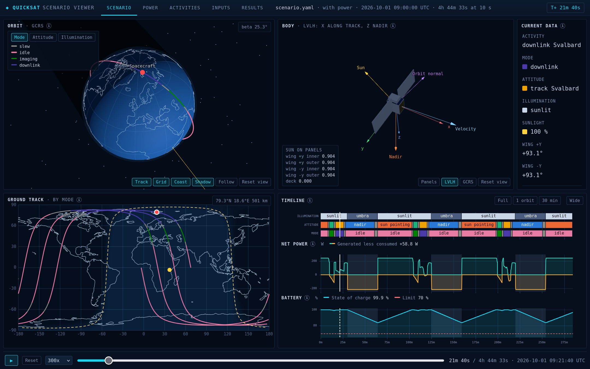
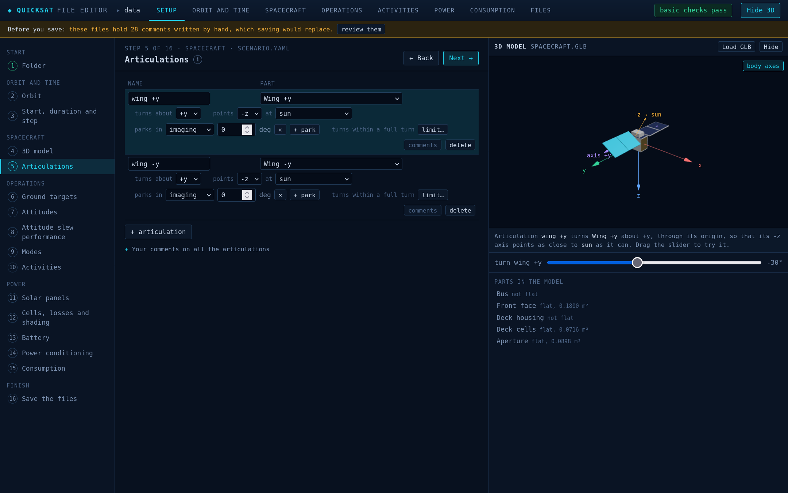
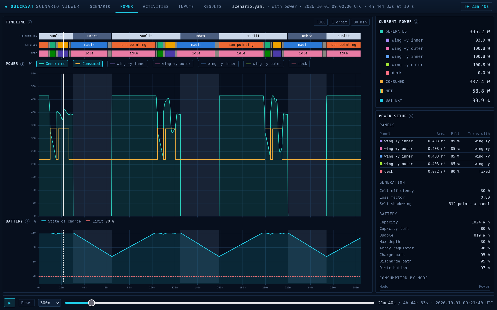

# quicksat

[](https://dl.circleci.com/status-badge/redirect/gh/egemenimre/quicksat/tree/master)
[](https://codecov.io/github/egemenimre/quicksat)

A first-pass satellite sizing tool, in two parts:

- **[Sizing](#sizing)** works out the mass, data, delta-V and attitude agility budgets. Each budget is a table, worked out from a few input files and a reference orbit.
- **[Scenario and power](#scenario-and-power-with-the-viewer)** flies the satellite through a timeline of activities on a real orbit, and checks the power: what the solar panels generate, what the equipment draws, and the battery between them. A 3D viewer shows the run.

The two parts share no input files. The budgets use a reference orbit, while the scenario needs a real orbit, with an epoch and a node. quicksat is kept simple on purpose. It gives a first-pass sizing, not a full systems engineering environment.



*The power sample in the viewer, during the downlink to Svalbard. The wings have turned to face the sun.*

## Install

```bash
conda env create -f environment.yml
conda activate quicksat
pip install -e .
```

## Sizing

The sizing sample is a small Earth observation satellite on a 500 km sun-synchronous orbit. Its files are in `sample/sizing/data/`. The workflow:

1. **Edit the files.** Double-click [`sample/sizing/editor/editor.html`](sample/sizing/editor/editor.html) to open the Sizing Editor in your browser. Its Setup tab takes you through every file, step by step, and the other tabs edit one budget each. Save the files, as a zip or one by one, and put them back in `sample/sizing/data/`. The files are YAML and CSV, with units written out, such as `750 g` or `800 Mbit/s`, so they can be edited by hand too.
2. **Run the notebooks** in `sample/sizing/`, in the order below. Each reads the files and builds its budget. Delta-V and agility also read the mass budget.
3. **Read the tables.** Each notebook ends with its budget laid out as a document, and the figures that answer the usual questions.

| Budget | What it gives | Sample | Reference |
|---|---|---|---|
| Mission | The reference orbit and the design life, which every budget shares | | [mission](docs/sizing/mission_ref.ipynb) |
| Mass | Dry and wet mass, by location, subsystem and owner, with two layers of margin | [mass](sample/sizing/mass_budget.ipynb) | [mass](docs/sizing/mass_budget_ref.ipynb) |
| Data | Data made against data sent down each day, and the memory needed between passes | [data](sample/sizing/data_budget.ipynb) | [data](docs/sizing/data_budget_ref.ipynb) |
| Delta-V | Delta-V by phase and type, and the propellant it needs | [delta-V](sample/sizing/delta_v_budget.ipynb) | [delta-V](docs/sizing/delta_v_ref.ipynb) |
| Agility | Slew times about roll and pitch, from the wheels and the inertia, with a wheel failed or not | [roll](sample/sizing/agility_roll.ipynb), [pitch](sample/sizing/agility_pitch.ipynb) | [agility](docs/sizing/agility_ref.ipynb) |
| Radiator | Not yet specified | | |

The sample works one satellite through each budget. The reference explains each input field, how each figure is worked out, and where the budget stops. For your own satellite, see [how to initialise a satellite](docs/guides/sizing/initialise_a_satellite.md).

## Scenario and power, with the viewer

The power sample flies a 510 km sun-synchronous orbit for three orbits, with imaging, a downlink to Svalbard, and wings that turn to the sun. Its files are in `sample/power/data/`: the scenario, the 3D model, the power system and the consumption table. The workflow:

1. **Edit the files.** Double-click [`sample/power/editor/editor.html`](sample/power/editor/editor.html) to open the editor in your browser. Its Setup tab takes you through every file, step by step, with an explanation of each choice. The other tabs edit the same data by theme, and a side panel shows the 3D model. Change something, such as the battery's capacity or an activity's trigger. Then save the files, as a zip or one by one, and put them back in `sample/power/data/`.
2. **Run the budget.** Run [`sample/power/power_budget.ipynb`](sample/power/power_budget.ipynb) in Jupyter, or `python -m quicksat.power sample/power/data sample/power/output` from the command line. Either flies the scenario, works out the generation, the loads and the battery, and checks the budget.
3. **Read the results.** The notebook shows each orbit's energy, the battery's charge, and three checks. The command prints the checks only. In the sample, the lowest charge is 83.6%, above its 70% limit, and every orbit has at least 16.5 W h to spare.
4. **See the run in the viewer.** Both write [`sample/power/output/power_viewer.html`](sample/power/output/power_viewer.html). Double-click it to see the run in 3D, with the ground track, the timeline and the power.



*The editor's Articulations step. The selected wing shows in the 3D panel, turned with the slider.*



*The viewer's Power tab. The power and the battery's charge follow the timeline, with the power setup beside them.*

The scenario sample works the same way, for the timeline alone: [`sample/scenario/editor/editor.html`](sample/scenario/editor/editor.html), then [`sample/scenario/scenario.ipynb`](sample/scenario/scenario.ipynb) or `python -m quicksat.scenario sample/scenario/data sample/scenario/output`, then `sample/scenario/output/scenario_viewer.html`.

| Part | What it gives | Sample | Reference |
|---|---|---|---|
| Scenario | The timeline on a real orbit: eclipses, attitudes, slews and ground passes, checked against each activity's needs | [scenario](sample/scenario/scenario.ipynb) | [scenario](docs/scenario/scenario_ref.ipynb) |
| Power generation | Each solar panel's power, with the wings that turn and the model's own shadows | [generation](sample/power/power_generation.ipynb) | [generation](docs/power/power_generation_ref.ipynb) |
| Power consumption | What the equipment draws in each mode | [consumption](sample/power/power_consumption.ipynb) | [consumption](docs/power/power_consumption_ref.ipynb) |
| Power budget | The battery's charge through the run, and whether each orbit has energy to spare | [budget](sample/power/power_budget.ipynb) | [budget](docs/power/power_budget_ref.ipynb) |

[How to edit, run and view a scenario](docs/guides/scenario/edit_and_view_a_scenario.md) goes round this loop in full, for the samples or a folder of your own. For what each field means, see [how to set up and run a scenario](docs/guides/scenario/set_up_a_scenario.md) and [how to set up and run a power budget](docs/guides/power/set_up_a_power_budget.md).

**The editors** open with the files of the folder that their page was written for. **Open a folder…**, on the first Setup step, reads any other folder, and **Open** on a tab reads one file. Or write a page for a folder of your own. A folder with a `scenario.yaml` gets the Scenario Editor, and a folder of sizing files gets the Sizing Editor:

```bash
python -m quicksat.editor sample/power/data sample/power/editor
```

**Keep your notes in `comments` fields.** Every block of a file can hold one, and so can the file as a whole, in the sizing files too. The editors write their own help as `#` lines, and replace any other `#` comments when they save. When an editor opens a file with such comments, it lists them, and moves each one you choose into a `comments` field. Write a `#` comment on the lines above what it describes, so that it goes to the right block.

## Documentation

The documentation follows the [Diátaxis](https://diataxis.fr/) split. The samples are tutorials, the guides show how to do one task, and the references explain how each part works. The notebooks, their data and the tests are grouped in three domains: `sizing`, `scenario` and `power`. Each set of notebooks reads its own copy of the inputs, so a change to a sample cannot change a figure in a reference.

Two documents cover the project as a whole:

- [`decisions.md`](docs/explanations/decisions.md) records the decisions that shaped quicksat, and why each was made.
- [`conventions.md`](docs/reference/conventions.md) holds the rules for the code and the notebooks: units, constants and tests. Read it before changing the code.

## License

GPL-3.0-or-later. See `LICENSE.md`.
